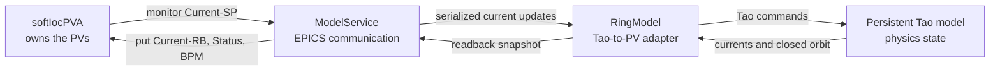

# Physics models

This directory contains accelerator models and services that publish simulated
EPICS behavior. `pv_model.py` keeps one persistent Tao model in memory, while
`service.py` connects that model to an independently running IOC using p4p.

Keep physics calculations, lattice transformations, and model-specific data
here. EPICS database generation, control-system mappings, and Phoebus displays
belong in [`../iocs/`](../iocs/).

## Architecture



The IOC owns and serves the PVs. The model service is a separate PVA client;
it does not create another IOC or serve duplicate PV names.

## Runtime flow

The service reads every corrector setpoint at startup, applies them to Tao in a
batch, and publishes the initial current, status, and BPM readbacks. It then
monitors setpoints and serializes each change through the single persistent Tao
instance. A change publishes the affected current readback and the recalculated
closed-orbit value for every BPM.

p4p monitor callbacks place changes onto that worker's queue instead of calling
Tao concurrently.

## Prerequisites

You need:

- EPICS Base with `softIocPVA`, `pvget`, and `pvput` on `PATH`.
- A Bmad/Tao installation with its shared library available to PyTao.
- The physicist-provided Bmad lattice file. It is not stored in this repository.
- Python 3.11 through 3.14 with the optional simulation dependencies.

From the repository root, install the project into the Python environment that
provides Bmad/Tao:

```powershell
python -m pip install -e ".[simulation]"
```

Activate that Python environment before invoking `narad-epics-model-service`.
The command is installed into the environment's `Scripts` directory; it is not
a global PowerShell command.

## Start the system

Run the IOC and model service in separate terminals from the repository root.

First regenerate the database when its source or mapper has changed:

```powershell
pixi run generate-toy-ring
```

In terminal 1, start the PVA-enabled IOC and leave it running:

```powershell
softIocPVA -d generated/toy_ring.db
```

Wait for `iocRun: All initialization complete`. In terminal 2, start the
persistent Tao model through the simulation environment. Replace the lattice path
with the actual physicist-provided `.bmad` file:

```powershell
pixi run -e simulation narad-epics-model-service C:\path\to\toy_ring.bmad
```

That command assumes the terminal is in `C:\git\eic-accelerator\narad-epics`.
From its parent directory, use the manifest explicitly:

```powershell
pixi run -e simulation --manifest-path narad-epics\pyproject.toml `
	narad-epics-model-service C:\path\to\toy_ring.bmad
```

Alternatively, after activating the environment where the editable simulation
install was performed, invoke its console script directly:

```powershell
narad-epics-model-service C:\path\to\toy_ring.bmad
```

The service should log the number of setpoint monitors after it reads all
setpoints, initializes Tao, and publishes the first readback snapshot.

## Verify the feedback loop

Read a setpoint, its current readback, and a BPM position:

```powershell
pvget inst:es12-t1:PS:H:Current-SP
pvget inst:es12-t1:PS:H:Current-RB
pvget inst:es12-bpm0:X-RB
```

Change the setpoint, then read the model outputs again:

```powershell
pvput inst:es12-t1:PS:H:Current-SP 1.0
pvget inst:es12-t1:PS:H:Current-RB
pvget inst:es12-bpm0:X-RB
```

The current readback should follow Tao's applied control value. BPM readbacks
should contain the newly calculated closed orbit.

Use `Ctrl+C` to stop the model service, then stop the IOC. Do not run multiple
IOCs with this database on the same network because clients may connect to
different servers advertising identical PV names.

If the IOC runs on another host, configure the usual PVA discovery environment
variables, such as `EPICS_PVA_ADDR_LIST`, before starting the service. Increase
`--timeout` when network or model startup latency exceeds the default five
seconds:

```powershell
pixi run -e simulation narad-epics-model-service C:\path\to\toy_ring.bmad `
	--timeout 15 --log-level DEBUG
```

## Conventions

- Document model assumptions and the source of physical constants or formulas.
- Add focused tests under [`../tests/`](../tests/) when introducing a model.

